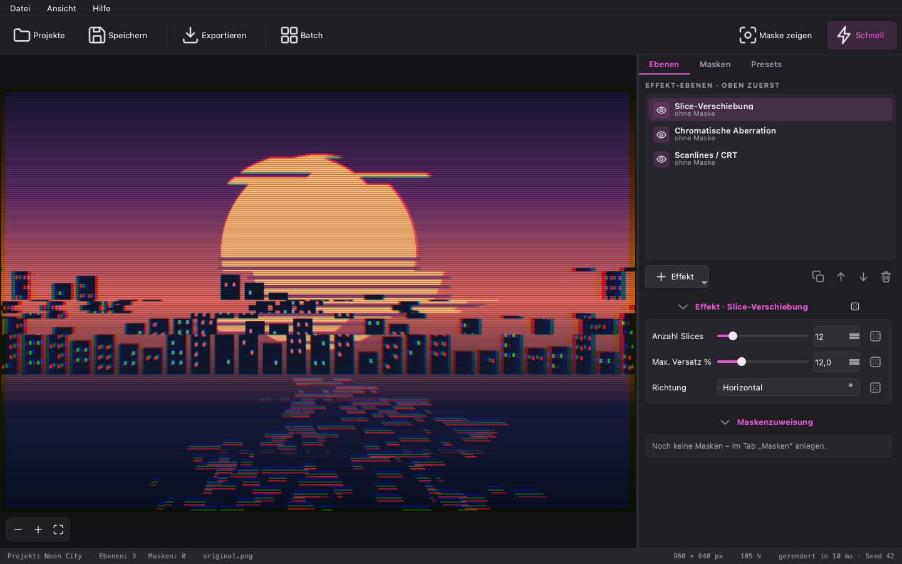
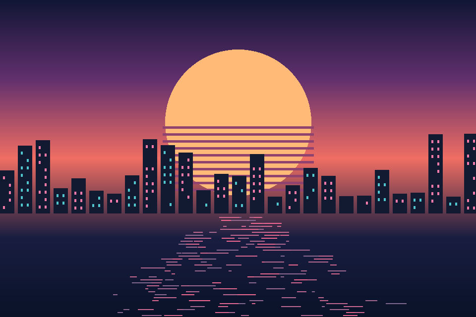
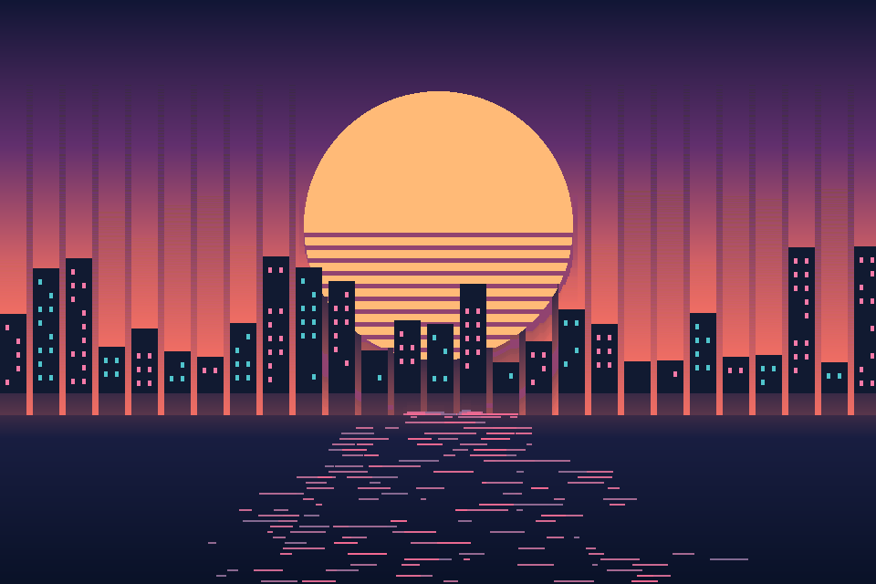
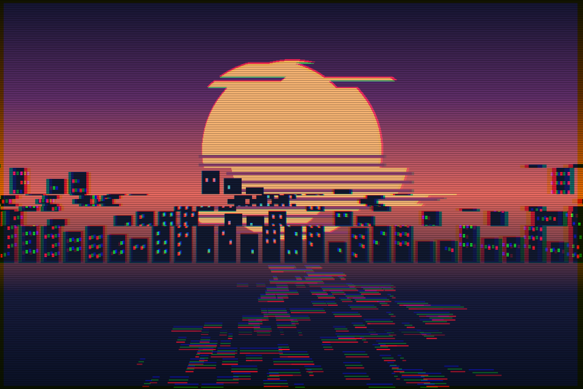
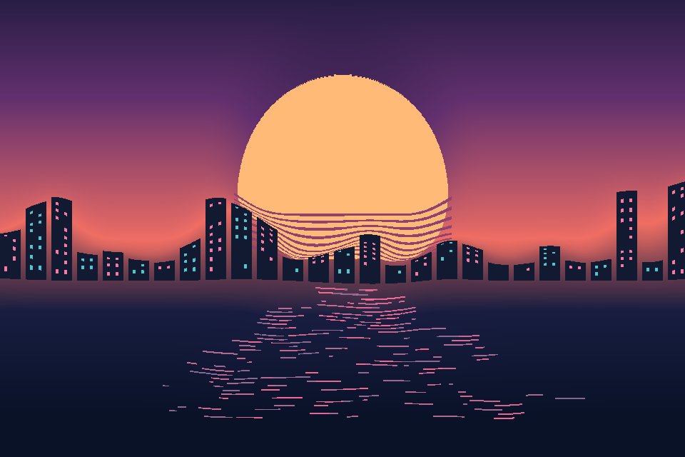

# PixelGlitch Studio

**Pixel-Sorting und Glitch-Art – geschichtet über Ebenen, geformt durch Masken, in Serie variiert.**

PixelGlitch Studio ist eine Desktop-Anwendung, mit der du Bilder gezielt zerlegen
und verfremden kannst. Kombiniere Effekte, begrenze ihre Wirkung auf einzelne
Bildbereiche und entdecke neue Varianten mit zufällig variierten Parametern.
Die Verarbeitung läuft lokal auf deinem Rechner, ohne Cloud oder Telemetrie.

**Aktueller Stand: 2.9.1 · Oberfläche: Deutsch · Python / PySide6 / NumPy / Pillow**



[Downloads](https://github.com/FlorianSawade/PixelGlitchStudio/releases) · [Installation](#installation-und-start) · [Erste Schritte](#erste-schritte) ·
[Beispiele](#beispiele) · [Versionshistorie](CHANGELOG.md) · [App bauen](BUILD.md) ·
[Lizenz](#lizenz)

## Was du damit machen kannst

- **Effekte stapeln:** Pixel Sort, RGB-Verschiebung, Signalstörungen,
  Databending, Pixel Stretch und Farbfilter kombinieren. Jede Ebene verarbeitet
  das Ergebnis der vorherigen.
- **Masken wiederverwenden:** Rechtecke, Ellipsen, Polygone, Verläufe und
  Bildmasken anlegen. Pro Ebene lassen sich Masken vereinigen, schneiden,
  abziehen, invertieren und mit weichen Kanten versehen.
- **Mit Presets starten:** Sechs mitgelieferte Vorlagen ausprobieren oder eigene
  Effektstapel samt Masken als `.pgpreset` speichern und austauschen.
- **Varianten erzeugen:** Parameter mit 🎲 markieren und im Batch variieren.
  Ergebnisse in der Galerie vergleichen, mit Sternen bewerten und eine
  Variante ins Projekt übernehmen.
- **Projekte mitnehmen:** `.pgsz` bündelt Einstellungen, Originalbild und
  Vorschaubild. PNG- und JPEG-Exporte stehen unabhängig davon zur Verfügung.
- **Direkt am Bild arbeiten:** Vorschau mit Zoom und Verschieben,
  Maskenbearbeitung im Bild sowie helles und dunkles Erscheinungsbild.

## Beispiele

Dasselbe Ausgangsbild, drei unterschiedliche Bearbeitungen. Die Ergebnisse
wurden mit der Bildverarbeitungs-Engine von PixelGlitch Studio und Seed `42`
erzeugt; das Ausgangsmotiv ist eine eigens dafür prozedural gezeichnete Grafik.

| Original | Pixel Sort · vertikal |
| --- | --- |
|  |  |
| **Signalstörung** | **Pixel Stretch · vertikal** |
|  |  |

Die Bilder und der Screenshot lassen sich mit
[`docs/generate_readme_assets.py`](docs/generate_readme_assets.py) neu erzeugen.

## Installation und Start

### Desktop-App herunterladen

Fertige App-Pakete werden unter [Releases](https://github.com/FlorianSawade/PixelGlitchStudio/releases)
bereitgestellt. Sie enthalten Python und die benötigten Bibliotheken. Wähle
das Paket für dein Betriebssystem und deine Prozessorarchitektur und entpacke
es vollständig. Falls noch keine veröffentlichte Release angezeigt wird,
verwende die Installation aus dem Quellcode weiter unten.

| System | Paket |
| --- | --- |
| macOS · Apple Silicon | `macos-arm64.zip` |
| macOS · Intel | `macos-x86_64.zip` |
| Windows · 64 Bit | `windows-x86_64.zip` |
| Linux · 64 Bit | `linux-x86_64.tar.gz` |

Die ersten Pakete sind nicht mit Entwicklerzertifikaten signiert.
[Installation, Systemvoraussetzungen und Prüfsummen](docs/INSTALLATION.md)
erklärt den Start auf den einzelnen Plattformen.

### Aus dem Quellcode starten

Verwende **Python 3.12** mit `pip` und Git. Python ist unter
[python.org](https://www.python.org/downloads/) erhältlich. Die folgenden Befehle
legen eine eigene Umgebung an, sodass die App-Abhängigkeiten getrennt von
anderen Python-Projekten bleiben.

Die Referenzsysteme für die Release sind macOS 15 (Apple Silicon und Intel),
Windows Server 2022 und Ubuntu 24.04. Die Installation aus dem Quellcode wurde
lokal auf macOS mit Python 3.12 geprüft. Die automatischen Prüfungen für alle
vier Ziele stehen im jeweiligen [Actions-Lauf](https://github.com/FlorianSawade/PixelGlitchStudio/actions/workflows/build.yml);
andere Betriebssystemversionen sind damit nicht automatisch bestätigt.

#### macOS / Linux

```bash
git clone https://github.com/FlorianSawade/PixelGlitchStudio.git
cd PixelGlitchStudio
python3.12 -m venv .venv
source .venv/bin/activate
python -m pip install -r requirements.txt
python run.py
```

#### Windows (PowerShell)

```powershell
git clone https://github.com/FlorianSawade/PixelGlitchStudio.git
cd PixelGlitchStudio
py -3.12 -m venv .venv
.\.venv\Scripts\python.exe -m pip install -r requirements.txt
.\.venv\Scripts\python.exe run.py
```

Für genau den Python-Paketstand der Release verwende stattdessen
`python -m pip install --require-hashes --only-binary=:all: -r requirements-release-lock.txt`
in der aktivierten Umgebung; unter Windows entsprechend
`.\.venv\Scripts\python.exe -m pip install --require-hashes --only-binary=:all: -r requirements-release-lock.txt`.
Diese Datei enthält auch die Build-Werkzeuge und die indirekten Abhängigkeiten.

Falls Git nicht installiert ist, kannst du das Repository auch über
**Code → Download ZIP** herunterladen, entpacken und im entpackten Ordner mit
dem Anlegen der virtuellen Umgebung beginnen.

## Erste Schritte

1. **Projekt anlegen:** Im Startfenster „Neues Projekt“ wählen und einen Namen
   vergeben. Anschließend über **Datei → Bild öffnen…** ein Bild laden oder es
   auf die Arbeitsfläche ziehen.
2. **Effekt hinzufügen:** Im Tab **Ebenen** über **+ Effekt** beispielsweise
   Pixel Sort auswählen und die Parameter anpassen. Alternativ im Tab
   **Presets** eine mitgelieferte Vorlage anwenden.
3. **Wirkung begrenzen:** Im Tab **Masken** eine Maske anlegen und bei der
   Effekt-Ebene im Abschnitt **Maskenzuweisung** zuweisen. Rechteck und Ellipse
   lassen sich direkt im Bild aufziehen; ein Doppelklick beendet ein Polygon.
4. **Varianten entdecken:** Gewünschte Parameter mit 🎲 markieren. Der Würfel
   im Effekt-Abschnitt variiert diese Parameter für die ausgewählte Ebene.
   **Batch** öffnet das Panel **Batch & Galerie** für eine ganze Serie.
5. **Ergebnis sichern:** Mit **Exportieren** ein Bild ausgeben oder mit
   **Speichern** das bearbeitbare Projekt als `.pgsz` ablegen.

**Vorschau und Export:** „Schnell“ verkleinert die Vorschau. Einzelexporte
werden in voller Auflösung berechnet; im Batch kannst du zwischen voller
Auflösung und einem Schnell-Batch in Vorschaugröße wählen. Große Bilder und
aufwendige Effektstapel können beim Export entsprechend länger dauern.

**Reproduzierbarkeit:** Ein Seed allein beschreibt keine vollständige
Bearbeitung. Für dasselbe Ergebnis brauchst du auch dasselbe Ausgangsbild,
denselben Effektstapel, dieselben Parameter und Masken. Speichere deshalb das
Projekt zusammen mit deinen Ergebnissen.

## Effekte im Überblick

| Bereich | Effekte |
| --- | --- |
| Sortierung | Pixel Sort mit verschiedenen Richtungen, Sortierschlüsseln und Intervallen |
| Glitch | RGB-Verschiebung, Kanaltausch, Slice-Verschiebung, Wellen-Verzerrung, chromatische Aberration, Scanlines/CRT, Byte-Glitch, JPEG-Korruption, Block-Shuffle, Echo/Geisterbild, Pixel Stretch |
| Farbe | Pixelate/Mosaik, Posterize, Rauschen, Bilateral-Glättung, Kuwahara, Farbton drehen, Helligkeit/Kontrast/Sättigung, Invertieren |

## Weiterführende Informationen

- [Changelog](CHANGELOG.md): Änderungen bis einschließlich Version 2.9.1.
- [Standalone-App bauen](BUILD.md): lokale Builds mit PyInstaller und Hinweise
  zu den Plattformen. Der [GitHub-Workflow](.github/workflows/build.yml) testet
  auf vier Plattformen und baut App-Pakete bei manuellem Start oder Versions-Tags.
- [Entwicklung und eigene Effekte](docs/DEVELOPMENT.md): Erweiterung der
  Effekt-Registry. Die Bildverarbeitungs-Engine kann auch ohne GUI verwendet
  werden.
- [Veröffentlichungsprüfung](docs/PUBLICATION_CHECK.md): geprüfter Stand und verbleibende Schritte.
- [Mitmachen](CONTRIBUTING.md): Entwicklungsumgebung, Tests und Hinweise für Pull Requests.
- [Sicherheitsprobleme melden](SECURITY.md): privater Meldeweg für Schwachstellen.
- [Fehler melden oder Funktionen vorschlagen](https://github.com/FlorianSawade/PixelGlitchStudio/issues):
  Bitte App-Version, Betriebssystem und Schritte zum Nachvollziehen angeben.

## Lizenz

Copyright (c) 2026 Florian Sawade.

PixelGlitch Studio steht unter der **GNU General Public License, Version 3**
(`SPDX-License-Identifier: GPL-3.0-only`). Den vollständigen Lizenztext findest
du in [LICENSE](LICENSE).

Du darfst die Software nutzen, verändern und weitergeben, auch kommerziell.
Wenn du die Software oder eine abgeleitete Version weitergibst, musst du die
Bedingungen der GPLv3 einhalten und insbesondere den zugehörigen Quellcode
entsprechend der Lizenz verfügbar machen. Die Software wird ohne Gewährleistung
bereitgestellt, soweit gesetzlich zulässig.

Verwendete Drittanbieter-Bibliotheken, insbesondere PySide6/Qt, NumPy und Pillow,
stehen unter ihren jeweiligen Lizenzen. Deren Bedingungen gelten zusätzlich,
wenn sie mit der Anwendung weitergegeben werden.

Konzept, Design und Entwicklung: **Florian Sawade**.
